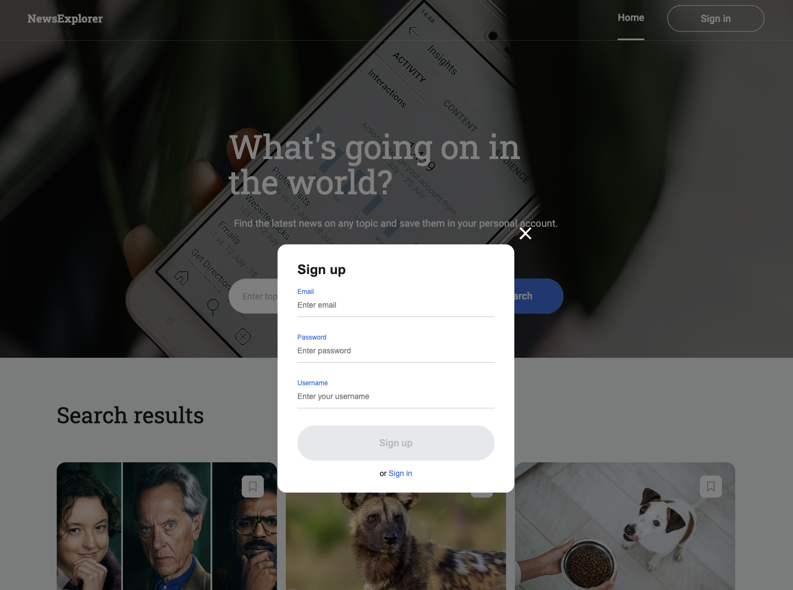
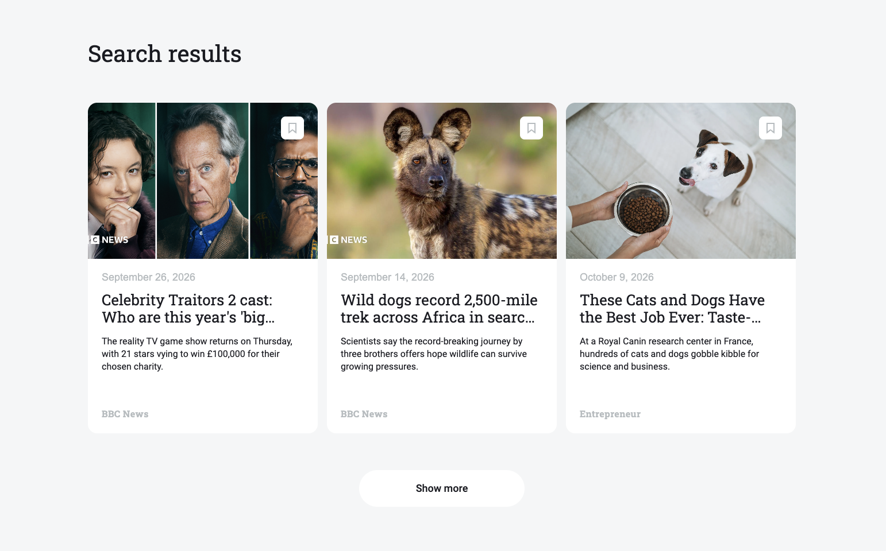
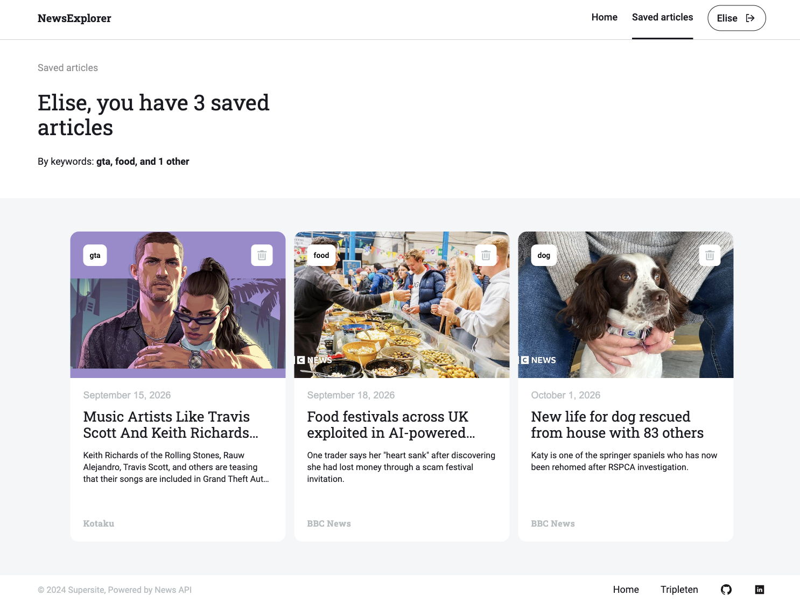
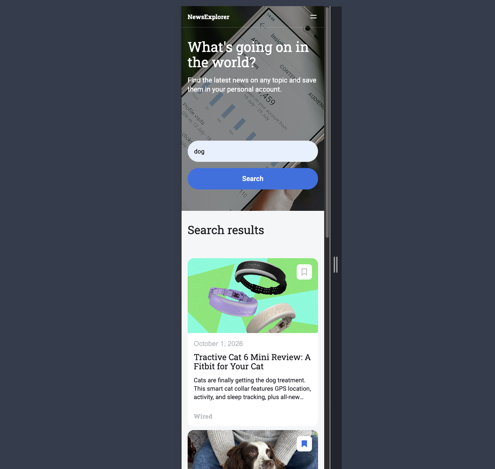
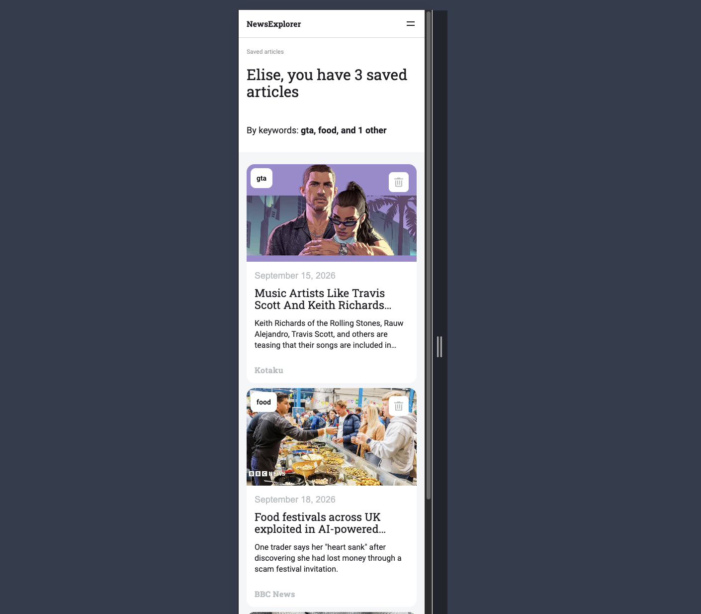

# News Explorer

News Explorer is a responsive web application that allows users to search for current news articles by keyword. Users can open the original articles, simulate signing in, and save articles to their personal collection.

## Features

- 🔎 Searches for news articles by keyword using NewsAPI
- 📰 Displays article images, titles, descriptions, sources, and publication dates
- 🔗 Opens original news articles in a new browser tab
- ⏳ Displays a preloader while search results are loading
- 📭 Displays a “Nothing found” message when no articles match the search
- 🔐 Includes sign-in and registration modals with form validation
- 👤 Displays logged-in and logged-out navigation states
- 🔖 Allows logged-in users to save and unsave articles
- 🗑️ Allows users to remove articles from the saved articles page
- 🏷️ Displays a summary of saved article keywords
- 📱 Adapts to desktop, tablet, and mobile screen sizes
- ☰ Includes a responsive mobile navigation menu
- 🧭 Uses React Router for the Home and Saved Articles pages

## Backend Repository

Coming Soon

## Tech Stack

### Frontend

- JavaScript
- React
- React Router
- Vite
- HTML5
- CSS3
- NewsAPI
- BEM methodology
- Responsive web design

### Development Tools

- Git
- GitHub
- ESLint
- Prettier
- Visual Studio Code
- Figma

## Deployment

💻 Live Site: [View project here](ADD_DEPLOYMENT_LINK_HERE)

## Images of the Site

### Home page

### Sign up

### Search Results

### Saved Articles Page

### Mobile Views

## Plans for Improvement

- 🔐 Connect the application to a backend authentication system
- 💾 Store users and saved articles in a database
- 🔄 Preserve the user’s session after refreshing the browser

## Project Pitch Video

- [Pitch Video](ADD_PITCH_VIDEO_LINK_HERE)
